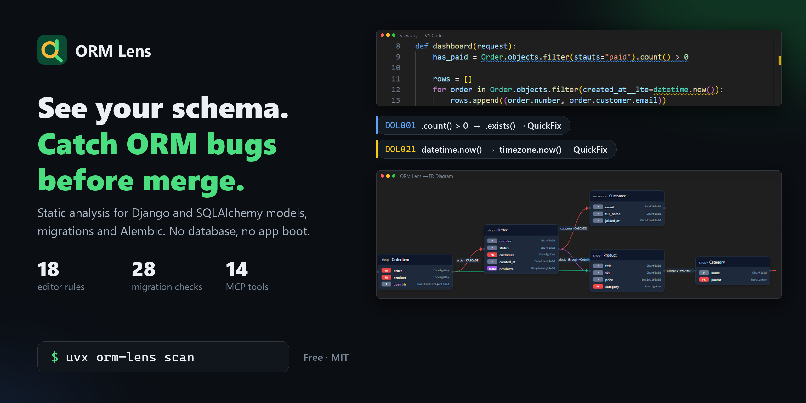
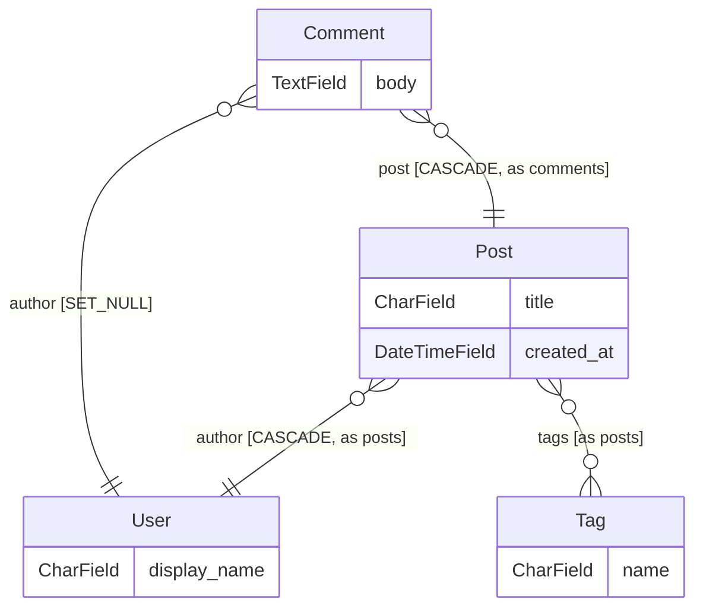

**[English](../../README.md)** · Русский · [Español](README.es.md) · [中文](README.zh.md)

<div align="center" markdown="1">



<br/>
<br/>

# ORM Lens

### ER-диаграммы, поиск N+1 и проверка риска миграций для Django — без запуска проекта.

ORM Lens читает исходный код и строит схему моделей Django. Схему можно смотреть в редакторе, проверять в CI и передавать AI-агенту через MCP. Для этого не нужны база данных, `runserver` или настроенное виртуальное окружение.

**Заменяет:** `graph_models` + `django-schema-graph` + вручную нарисованные ER-диаграммы + ручной поиск связей через `grep`.

<br/>

<!-- Hero — LIVE badges only, minimal (FastAPI / Rich pattern) -->

[](https://pypi.org/project/orm-lens/)
[](https://pypi.org/project/orm-lens/)
[](https://pypi.org/project/orm-lens/)
[](https://github.com/FROWNINGdev/orm-lens/actions/workflows/ci.yml)
[](https://pypistats.org/packages/orm-lens)
[](../../LICENSE)

<br/>

<!-- One-click install per platform -->

[](https://marketplace.visualstudio.com/items?itemName=frowningdev.django-orm-lens)
[](https://open-vsx.org/extension/frowningdev/django-orm-lens)
[](https://github.com/FROWNINGdev/orm-lens/pkgs/container/orm-lens)

<br/>

<sub>Упоминается в <a href="https://django-news.com/archive/issue-347-django-61-release-candidate-1-released/">Django News #347</a> · <a href="https://pycoders.com/issues/746">PyCoder's Weekly #746</a></sub>

</div>

---

## ⚡ Быстрый старт

```bash
uvx orm-lens scan -f table   # every app and model at a glance
uvx orm-lens nplusone        # N+1 loops, with the select_related to add
uvx orm-lens migration-risk  # migrations that lock tables or fail on existing rows
```

Эти команды покажут приложения и модели, найдут N+1 в циклах и проверят миграции. Их можно запустить сразу после клонирования проекта, даже без настроенного окружения и модуля настроек Django. Для `uvx` нужен [uv](https://docs.astral.sh/uv/); вместо него можно использовать `pipx run`.

**Выберите, где удобнее работать:** в редакторе, терминале или через AI-агента.

| Кто вы | Установка | Что вы получаете |
|---|---|---|
| **Пользователь редактора** — VS Code / Cursor / Windsurf / VSCodium | `code --install-extension frowningdev.django-orm-lens` | Дерево в боковой панели, обновляемая ER-диаграмма, hover-карточки, 16 QuickFix-правил |
| **Пользователь терминала / CI** | `pip install orm-lens` | 13 подкоманд, SARIF + PR-аннотации, pre-commit-хуки, GitHub Action |
| **Пользователь AI-агентов** — Cursor / Claude Code / Aider / Zed / Continue | `pip install "orm-lens[mcp]"` | 14 MCP-инструментов для чтения и анализа схемы по исходному коду |

Настройка MCP — один JSON-блок, см. [Интеграции](#-интеграции). Укажите в `ORM_LENS_ROOT` абсолютный путь к вашему Django-проекту.


---

## 🆓 Бесплатно, под лицензией MIT

Проверка изменений схемы в PR, поиск N+1 с учётом вызовов других функций, сверка моделей с миграциями и рекомендации по индексам часто доступны только по подписке. В ORM Lens эти возможности бесплатны.

Не нужны аккаунт и лицензии на каждого участника команды. Телеметрии нет.

| Возможность, которую обычно продают | Здесь |
|---|---|
| Проверка изменений схемы в PR с обновлением одного комментария | [`blast-radius`](../rules/blast-radius.md) + Action |
| Анализ QuerySet с учётом его передачи между функциями | [`nplusone`](../rules/nplusone.md) |
| Поиск расхождений между моделями и миграциями | [`drift`](../rules/drift.md) |
| Предложения индексов по фактическому использованию QuerySet | `suggest-indexes` |
| Риск миграции с поправкой на реальный размер таблицы | `blast-radius --stats` |
| Оценка последствий миграции с удалением данных или объектов схемы | [`blast-radius`](../rules/blast-radius.md) |
| Поиск кода, который затронет удаление поля | `impact` |

**Платного тарифа нет и не планируется.** Если инструмент оказался полезен, поддержите проект звездой на GitHub.


---

## 📊 Проект в цифрах

<div align="center" markdown="1">

<!-- Traction — LIVE counters only, no hardcoded numbers -->

[](https://github.com/FROWNINGdev/orm-lens/stargazers)
[](https://github.com/FROWNINGdev/orm-lens/network/members)
[](https://pypi.org/project/orm-lens/)
[](https://pypistats.org/packages/orm-lens)
[](https://marketplace.visualstudio.com/items?itemName=frowningdev.django-orm-lens&ssr=false#review-details)
[](https://github.com/FROWNINGdev/orm-lens/graphs/contributors)
[](https://github.com/FROWNINGdev/orm-lens/commits/main)

<br/>

<!-- Directory presence — one row per registry, no duplicates -->

[](https://registry.modelcontextprotocol.io/)
[](https://glama.ai/mcp/servers/FROWNINGdev/orm-lens)
[](https://github.com/punkpeye/awesome-mcp-servers)
[](https://mcp.so/servers/orm-lens)

</div>

> Пользуетесь ORM Lens? **[Поставьте звезду на GitHub](https://github.com/FROWNINGdev/orm-lens/stargazers)** — так проект будет проще найти другим разработчикам.

### 📈 Рост звёзд

<div align="center">
  <a href="https://www.star-history.com/?repos=FROWNINGdev%2Form-lens&type=date&legend=top-left">
    <picture>
      <source media="(prefers-color-scheme: dark)" srcset="https://api.star-history.com/chart?repos=FROWNINGdev/orm-lens&type=date&theme=dark&legend=top-left&sealed_token=Bt09MbOICQzMe0Yzud5Up9GEQwXZReJEx6n5AS5Sl2GB3UtfipcUjyojd3g8PEfAkOFiZgy5uJel_LoNeLy_r7I4pyGhnYdUyQIbJDQzKlx1oA3BLRkxlAgby995WLgF7Ze1fdg2TlS6EJH0aRozsCZnwP1rtqXbMCWRMu1c9qpFrPcKxgFNd1G9fWMT" />
      <source media="(prefers-color-scheme: light)" srcset="https://api.star-history.com/chart?repos=FROWNINGdev/orm-lens&type=date&legend=top-left&sealed_token=Bt09MbOICQzMe0Yzud5Up9GEQwXZReJEx6n5AS5Sl2GB3UtfipcUjyojd3g8PEfAkOFiZgy5uJel_LoNeLy_r7I4pyGhnYdUyQIbJDQzKlx1oA3BLRkxlAgby995WLgF7Ze1fdg2TlS6EJH0aRozsCZnwP1rtqXbMCWRMu1c9qpFrPcKxgFNd1G9fWMT" />
      
    </picture>
  </a>
</div>

---

## ⚡ Установка

**VS Code / Cursor / Windsurf** (VS Code Marketplace):

```bash
code --install-extension frowningdev.django-orm-lens
```

**VSCodium / code-server / Gitpod / любой OSS-форк Code** (Open VSX):

```bash
codium --install-extension frowningdev.django-orm-lens
```

Или найдите **`ORM Lens`** во вкладке Extensions — в обоих реестрах один и тот же издатель `frowningdev`.

**Терминал и AI-агенты для программирования:**

```bash
pip install orm-lens              # CLI only
pip install "orm-lens[mcp]"       # + MCP server for AI agents
```

Требуется Python 3.9+ (MCP-сервер — 3.10+). У CLI нет зависимостей, необходимых в runtime.

**Docker (v0.6+):**

```bash
docker run --rm -v "$PWD:/workspace" ghcr.io/frowningdev/orm-lens scan --path .
```

Образ доступен для amd64 и arm64. Устанавливать Python на хост не нужно. Подходит для CI и разовых проверок.

<br/>

## 🎯 Проблема

> **Работает офлайн. Работает без настроенного виртуального окружения. Работает на чужом ноутбуке. Работает в CI.**

Вы открываете Django-проект. В нём 20 приложений. Нужно ответить на простой вопрос:

> _«В каком приложении живёт модель `Order` и как она связана с `User`?»_

Обычно приходится искать `models.py`, открывать несколько файлов и вручную прослеживать связи вроде `ForeignKey('otherapp.Something')`. Чем больше проект, тем сложнее держать всю схему в голове.

На знакомство со схемой уходит время, которое можно потратить на саму задачу.

<br/>

## ✨ С ORM Lens

<table>
<tr>
<td width="50%" valign="top">

### 📚 Дерево приложений и моделей

В боковой панели видны приложения, модели, поля и параметры `Meta`. Элементы сгруппированы по приложениям и отсортированы по алфавиту. Раскройте нужную модель, чтобы посмотреть подробности.

По значкам легко отличить `CharField` от `ForeignKey` и от `ManyToManyField`.

</td>
<td width="50%" valign="top">

### 🕸️ Обновляемая ER-диаграмма

Одна команда открывает ER-диаграмму всей схемы на Mermaid. Она обновляется при изменении кода и экспортируется в SVG.

`ForeignKey`, `OneToOneField` и `ManyToManyField` превращаются в связи с указанием кратности.

</td>
</tr>
<tr>
<td width="50%" valign="top">

### 🔎 Подсказки для связей

Наведите курсор на `ForeignKey('app.Model')` в Python-файле. В подсказке появятся поля и связи целевой модели, а также ссылка «Jump to» для перехода к её определению.

</td>
<td width="50%" valign="top">

### 🧭 Переход к определению

Нажмите на поле в дереве, чтобы перейти к нужной строке кода. Дерево можно отфильтровать по имени приложения или модели. Поддерживаются модели, разбитые на несколько файлов в пакете `models/`.

</td>
</tr>
<tr>
<td width="50%" valign="top">

### ⚡ Без настройки Django

ORM Lens разбирает `models.py`, не запуская код проекта. Не нужно задавать `DJANGO_SETTINGS_MODULE`, запускать сервер или устанавливать зависимости проекта.

</td>
<td width="50%" valign="top">

### 🎨 Привычный интерфейс VS Code

Расширение использует выбранную в редакторе тему оформления, значки, шрифты и сочетания клавиш.

</td>
</tr>
</table>

<br/>

## 🚀 Дополнительные возможности

<table>
<tr>
<td width="50%" valign="top">

### 🎯 Быстрые исправления в редакторе (16 правил)

Проверки `.py`-файлов находят лишний `.count() > 0`, `null=True` у `CharField`, пропущенный `on_delete`, вызовы `datetime.now()` и другие проблемы. У правил есть коды (`DOL001`–`DOL032`), как в Ruff, и настраиваемый уровень важности. Для исправлений указывается, насколько безопасно их применять, — по аналогии с Clippy.

Отключение проверок в коде: `# orm-lens-disable-next-line DOL007`.

</td>
<td width="50%" valign="top">

### 🧪 Генератор фабрик

Откройте контекстное меню модели, чтобы сгенерировать заготовку `DjangoModelFactory` для `factory_boy`. Провайдеры Faker подбираются по типам полей: длина текста учитывает `max_length`, для `DecimalField(N,D)` задаётся `left_digits=N-D`, для `choices=` используется `Iterator`, а для M2M — `@post_generation`. Для связанных через FK моделей также создаются фабрики.

Также доступно как CodeLens над каждым классом модели.

</td>
</tr>
<tr>
<td width="50%" valign="top">

### 🕰 Сравнение схемы между коммитами (Time-Travel)

Выберите `models.py` и два коммита. ORM Lens подготовит Markdown-отчёт для PR: какие модели добавили, удалили, переименовали или изменили (`AddModel` / `DropModel` / `RenameModel` / `ModifyModel`). Переименования определяются по сходству имён и состава полей с оценкой уверенности.

Распознанное переименование отображается отдельно, а не как удаление и добавление модели. Если содержимое `models.py` между коммитами не менялось, повторный разбор не нужен: результат хранится в LRU-кэше по SHA Git-объекта.

</td>
<td width="50%" valign="top">

### 🔎 Анализ влияния

«Что сломается, если удалить это поле?» — правый клик по полю или модели → сканирование всей рабочей области с группировкой по слоям Django (models, serializers, forms, admin, views, urls, templates, tests, migrations).

Для каждого результата указан уровень уверенности: **Certain / Likely / Possibly**. Обрабатываются строковые ORM-ссылки (`order_by("-author")`), условия поиска в именованных аргументах (`filter(author__id=1)`), кортежи `Meta.fields` и переменные шаблонов.

</td>
</tr>
<tr>
<td width="50%" valign="top">

### ⚡ Интерактивный конструктор запросов

Выберите поле или модель, откройте контекстное меню и укажите шаблон запроса. Заготовка вставится в текущую позицию курсора или в новый файл без имени. Между параметрами можно переходить клавишей Tab.

`.filter(field=?)` на FK автоматически дописывает `.select_related(...)`, `.annotate(post_count=Count('post_set'))` учитывает `related_name`, `.prefetch_related` для M2M, `.values('field').distinct()`, `.only('field')`.

</td>
<td width="50%" valign="top">

### 🎨 Удобная боковая панель

Дерево сохраняет раскрытые узлы при обновлении. В подсказках есть форматирование и ссылки на команды. Значок на панели действий показывает количество замечаний DOL###.

Поля с проблемами отмечены в дереве: красный `!` — у FK без `on_delete`, жёлтый `~` — у строковых полей с `null=True`. Отметка также видна у родительской модели, как статус изменений в Git.

</td>
</tr>
</table>

<br/>

## 📸 Как это выглядит

<div align="center" markdown="1">

</div>

**Живой пример** — настоящий вывод `orm-lens er`, GitHub рендерит его прямо здесь:



**Также входит в расширение:**

- 🕸️ **Обновляемая ER-диаграмма** — связи с указанием кратности в Mermaid, подписи на рёбрах (`CASCADE`, `through Model`, `as related_name`), учёт темы, экспорт в SVG одним кликом
- 🔎 **Всплывающие подсказки** — над любым `ForeignKey('app.Model')` или `ManyToManyField(...)`, со ссылкой для перехода одним кликом
- 🧭 **CodeLens** — над каждой строкой `class Model`: количество полей, количество связей и действие **Open ER diagram**
- 🎨 **Именованные темы** — `auto` / `default` / `dark` / `forest` / `neutral` для webview с диаграммой

<br/>

## 🤖 CLI и AI-агенты

Анализ схемы доступен и в отдельном Python-пакете. Вместе с ним можно установить **MCP-сервер (Model Context Protocol)**: он позволяет AI-агентам изучать модели и связи, не импортируя Django и не запуская приложение.

### CLI

```bash
orm-lens scan -f json                 # every app, every model, every field
orm-lens describe blog.Post           # one model in Markdown
orm-lens list | fzf                   # flat app.Model — pipes anywhere
orm-lens er > schema.mmd              # ER diagram — Mermaid (default)
orm-lens er -f dbml > schema.dbml     # …or DBML: paste into dbdiagram.io
orm-lens er -f d2 > schema.d2         # …or D2 / plantuml
orm-lens diff before.json after.json  # what a PR changes structurally
orm-lens nplusone --format github     # N+1 findings as PR annotations
orm-lens migration-risk -f sarif      # SARIF for GitHub Code Scanning
orm-lens suggest-indexes blog.Post    # Meta.indexes proposals from usage
orm-lens signals                      # sender→signal→handler graph
orm-lens migration-deps blog -f mermaid   # per-app migration DAG
orm-lens cascade blog.Author          # what one delete() takes down
```

Все команды, кроме `stats-sql` и `mcp`, принимают `--path <dir>` и `--exclude <glob>`; флаги команды показывает `orm-lens <cmd> --help`. `nplusone` / `migration-risk` / `diff` выходят с кодом `1` при обнаружении проблем — добавьте их в CI, чтобы блокировать PR при регрессиях.

### MCP-сервер

Добавьте сервер в настройки AI-агента. Через него доступны четырнадцать инструментов, которые читают код, но не изменяют его:

| Инструмент | Назначение |
| --- | --- |
| `list_apps` | Каждое Django-приложение в рабочей области с числом моделей |
| `list_models` | Плоский список `app.Model`, опциональный фильтр по приложению |
| `describe_model` | Поля, связи и параметры `Meta` выбранной модели |
| `find_relations` | Входящие и исходящие связи одной модели |
| `cascade_preview` | Последствия одного вызова `delete()`, с группировкой по `on_delete`, и `post_delete`-обработчики, которые пропускает `DB_CASCADE` из Django 6.1 |
| `er_diagram` | ER-диаграмма — `mermaid` / `dbml` / `d2` / `plantuml` / `dot` |
| `describe_migration_dependency` | DAG миграций по приложениям: корни, листья, зависимости между приложениями |
| `suggest_indexes` | Рекомендации по `Meta.indexes` на основе использования QuerySet в коде |
| `signal_graph` | Граф sender→signal→handler из декораторов `@receiver` |
| `migration_risk` | Опасные изменения схемы в миграциях Django и ревизиях Alembic (блокировки таблиц, удалённые столбцы) |
| `blast_radius` | Что затрагивает разрушающая миграция: её риски, код, который всё ещё к ней обращается, последствия каскада |
| `drift` | `makemigrations --check` без запуска Django — миграции сравниваются с `models.py` |
| `impact` | Все обращения к полю или модели по имени, сгруппированные по слоям Django |
| `nplusone_scan` | Поиск N+1 во всей рабочей области без запуска кода |

```bash
# Start it directly
orm-lens-mcp

# Or via the CLI subcommand
orm-lens mcp
```

**Путь к проекту (py-1.3.0+).** В вызове любого инструмента можно передать `workspace_root`. Сервер использует этот аргумент, затем переменную `$ORM_LENS_ROOT`, а если не задано ни то ни другое — текущий каталог. Если путь неверен или в нём нет Django-проекта, сервер вернёт ошибку с подсказкой (`{"error": "WORKSPACE_NOT_DJANGO", "hint": "…"}`). По ней агент сможет исправить путь. Чтобы ограничить доступ к каталогам, задайте `ORM_LENS_ALLOWED_ROOTS`. Разделитель путей — `;` в Windows и `:` в остальных системах.

<br/>

## 🛡️ Защитите свой CI

Проверки можно включить в процесс ревью, чтобы находить проблемы до слияния PR. Выберите один из трёх вариантов:

**pre-commit** — два хука, локально ничего ставить не нужно:

```yaml
# .pre-commit-config.yaml
repos:
  - repo: https://github.com/FROWNINGdev/orm-lens
    rev: py-v1.18.1
    hooks:
      - id: orm-lens-nplusone
      - id: orm-lens-migration-risk
```

**GitHub Action** — результаты проверок появляются в виде замечаний в PR, без дополнительных разрешений:

```yaml
- uses: FROWNINGdev/orm-lens@action-v1
  with:
    command: migration-risk      # or: nplusone
    format: github               # ::error / ::warning annotations on the diff
```

**SARIF → Code Scanning** — результаты проверок попадают во вкладку Security репозитория:

```yaml
- run: |
    pip install orm-lens
    orm-lens migration-risk --format sarif --exit-zero > lens.sarif
- uses: github/codeql-action/upload-sarif@v3
  with:
    sarif_file: lens.sarif
```

Для CI используются коды выхода: `diff` и `nplusone` выходят с `1` при обнаружении проблем, `migration-risk` — с `1` при критических проблемах. Добавьте `--exit-zero` для режима «только отчёт».

<br/>

## 🔌 Интеграции

| Клиент | Как подключить | Статус |
|---|---|:-:|
| **VS Code** | `code --install-extension frowningdev.django-orm-lens` | ✅ |
| **Cursor** | тот же VSIX + опциональная MCP-запись в `~/.cursor/mcp.json` | ✅ |
| **Windsurf / VSCodium / любой форк Code** | установите VSIX с [Marketplace](https://marketplace.visualstudio.com/items?itemName=frowningdev.django-orm-lens) или из [GitHub Releases](https://github.com/FROWNINGdev/orm-lens/releases) | ✅ |
| **Aider** | добавьте `orm-lens-mcp` в свой `mcp.json` | ✅ (через MCP) |
| **Continue.dev** | зарегистрируйте MCP-сервер в `~/.continue/config.json` | ✅ (через MCP) |
| **Zed** | зарегистрируйте MCP-сервер в настройках Zed | ✅ (через MCP) |
| **Любой MCP-совместимый клиент** | укажите в `command` путь к `orm-lens-mcp`, задайте `ORM_LENS_ROOT` | ✅ |
| **pre-commit** | `repo: https://github.com/FROWNINGdev/orm-lens` + два id хуков | ✅ |
| **GitHub Actions** | `uses: FROWNINGdev/orm-lens@action-v1` — аннотации или SARIF | ✅ |
| **Виден в [MCP Registry](https://registry.modelcontextprotocol.io/)** | официальный каталог серверов Model Context Protocol | ✅ |
| **Обычный терминал / CI** | `pip install orm-lens && orm-lens scan` | ✅ |

### Пример: Cursor / любой MCP-клиент

```jsonc
{
  "mcpServers": {
    "orm-lens": {
      "command": "orm-lens-mcp",
      "env": { "ORM_LENS_ROOT": "/abs/path/to/your/project" }
    }
  }
}
```

<br/>

## ⚡ Производительность

В тестах используются копии моделей из **Zulip, Saleor, Wagtail, django CMS и Mezzanine**: 59 моделей, 13 478 строк кода. Полный разбор на ноутбуке занимает около **20 мс** (лучший результат из трёх запусков — 21 мс). В CI для каждой конфигурации проверяется, что разбор укладывается в 2 секунды.

Воспроизведите это сами:

```bash
git clone https://github.com/FROWNINGdev/orm-lens && cd orm-lens/cli
pip install -e . && python -m pytest tests/test_golden_fixtures.py tests/test_golden_snapshots.py -q
```

<br/>

## 🎯 Для кого это

- **Django-разработчики**, попадающие в кодовую базу с 10+ приложениями и теряющиеся в разросшемся `models.py`.
- **Разработчики на подряде и фрилансеры**, которым нужно быстро разобраться в незнакомом Django-проекте.
- **Команды, принимающие новых сотрудников**: схема помогает объяснить устройство проекта без отдельного сервиса документации.
- **Продвинутые пользователи AI-агентов** (Cursor / Aider / Zed / Continue / любой MCP-совместимый клиент), которым нужно, чтобы агент точно отвечал на вопросы о схеме — не получая учётных данных БД и не запуская Django.
- **CI-пайплайны**, проверяющие форму схемы (например, «не сломали ли мы случайно `related_name`?»), не импортируя проект.
- **Разработчики, работающие в одиночку**, которым нужно изучить проект без настройки окружения, запуска сервера и миграций.

<br/>

## 🗺️ Другие инструменты для работы со схемой

Для изучения моделей Django есть несколько подходов. Вот что требуется для каждого из них:

| Сегмент | Существующий вариант | Что требуется и какие есть ограничения |
|---|---|---|
| Генерация диаграммы через Django | `django-extensions graph_models` | Требует Graphviz + настройки Django + рабочий URL БД |
| Просмотр в браузере | `django-schema-graph` | Требует запущенный Django-сервер; ещё одна вещь, которая может сломаться |
| Админка | Django Admin | Требует runserver + аутентификацию + базу данных — отлично для данных, не для архитектуры |
| Плагин к редактору | Django Structure в PyCharm | Привязан к PyCharm; нет CLI, нет интеграции с AI-агентами |
| MCP-сервер | (до сих пор — ничего) | AI-агенты угадывают вашу схему по исходникам, с ошибками |

**ORM Lens доступен в трёх вариантах:** расширение для VS Code и его форков, CLI без зависимостей для терминала и CI, MCP-сервер для AI-агентов. Все варианты анализируют исходный код без запуска Django и распространяются бесплатно под MIT.

<br/>

## 🤔 Чем это отличается?

| | **ORM Lens** | `django-extensions graph_models` | `django-schema-graph` | Django Admin | PyCharm Django Structure |
|---|:-:|:-:|:-:|:-:|:-:|
| Не требует запуска Django-проекта | ✅ | ❌ | ❌ | ❌ | ⚠️ |
| Не требует Graphviz и сервера | ✅ | ❌ | ❌ | ❌ | ❌ (нужен PyCharm) |
| Работает в VS Code / Cursor / любом форке Code | ✅ | ❌ | ❌ | ❌ | ❌ |
| Дерево в боковой панели редактора | ✅ | ❌ | ❌ | ❌ | ✅ |
| Обновляемая ER-диаграмма | ✅ | ✅ | ✅ | ❌ | ❌ |
| Всплывающие подсказки на `ForeignKey` | ✅ | ❌ | ❌ | ❌ | ⚠️ |
| CodeLens над классами моделей | ✅ | ❌ | ❌ | ❌ | ❌ |
| Поддержка моделей в нескольких файлах пакета `models/` | ✅ | ⚠️ | ⚠️ | ✅ | ✅ |
| CLI для терминала / CI | ✅ | ⚠️ | ❌ | ❌ | ❌ |
| MCP-сервер для AI-агентов | ✅ | ❌ | ❌ | ❌ | ❌ |
| Виден в [MCP Registry](https://registry.modelcontextprotocol.io/) | ✅ | ❌ | ❌ | ❌ | ❌ |
| Бесплатный и open-source (MIT) | ✅ | ✅ | ✅ | ✅ | ❌ (платная IDE) |
| Поддержка версий Django | **4.0 – 6.1** | последняя | 3.2 – 4.1 (не обновляется с 2023) | последняя | последняя |

> *`django-schema-graph` не обновлялся с 2023-05 и не тестирует Django 5.x.*

### Когда вам нужно что-то другое

Для анализа запросов во время работы приложения подойдёт **django-debug-toolbar**, для сохранения истории профилирования — **django-silk**. Число запросов в тестах можно проверять с **django-perf-rec**, а следить за приложением в продакшене — через **Scout / Sentry**. ORM Lens решает другую задачу: проверяет исходный код ещё до запуска приложения, в том числе в CI и через AI-агента.

<br/>

## ⚙️ Конфигурация

Обычно достаточно настроек по умолчанию. При необходимости их можно изменить:

```jsonc
// .vscode/settings.json
{
  "djangoOrmLens.excludeGlobs": [
    "**/migrations/**",
    "**/node_modules/**",
    "**/venv/**",
    "**/.venv/**",
    "**/env/**"
  ],
  "djangoOrmLens.autoRefresh": true
}
```

| Настройка | Тип | По умолчанию | Что делает |
|---|---|---|---|
| `djangoOrmLens.excludeGlobs` | `string[]` | См. выше | Glob-шаблоны путей, исключённых из сканирования |
| `djangoOrmLens.autoRefresh` | `boolean` | `true` | Повторное сканирование при изменениях `models.py` |
| `djangoOrmLens.codeFixes.enabled` | `boolean` | `true` | Включение проверок DOL### и быстрых исправлений |
| `djangoOrmLens.rules` | `object` | `{}` | Уровень важности каждого правила: `{ "DOL007": "off", "DOL013": "error" }` |
| `djangoOrmLens.rulesSelect` | `string[]` | `[]` | Select в стиле Ruff. `["DOL0"]` запускает только правила queryset+model |
| `djangoOrmLens.rulesIgnore` | `string[]` | `[]` | Ignore в стиле Ruff. `["DOL03"]` отключает правила для форм и представлений |

<br/>

## 🔬 Каталог правил

В редакторе доступны 16 проверок (`DOL001`–`DOL032`). Для каждой можно настроить уровень важности; у исправлений указан уровень безопасности применения. В CLI есть отдельные проверки рисков миграций и анализатор N+1. **Для каждого правила есть страница с описанием и примерами.**

| Категория | Правила | Примеры |
|---|---|---|
| [Queryset](../rules/README.md) | `DOL001`–`DOL007` | `.count() > 0` → `.exists()`, доступ к FK в циклах (N+1) |
| [Определение модели](../rules/README.md) | `DOL011`–`DOL015` | `ForeignKey` без `on_delete`, `null=True` на строковых полях |
| [Datetime](../rules/README.md) | `DOL021`–`DOL022` | `datetime.now()` → `timezone.now()` |
| [Формы / представления](../rules/README.md) | `DOL031`–`DOL032` | `locals()` в `render()`, `Meta.fields = '__all__'` |
| [Риски миграций](../rules/migrations.md) | 16 правил | Добавление NOT NULL без default, создание индексов с блокировкой таблицы, необратимые миграции данных |
| [Статический N+1](../rules/nplusone.md) | 1 анализатор | Доступ к FK/M2M в циклах без `select_related` / `prefetch_related` |

→ **[Полный справочник правил](../rules/README.md)** — каждый код с примерами «плохо/хорошо», описанием быстрых исправлений и способов отключить проверку.

### Отключение проверок в коде

```python
# orm-lens-disable-next-line DOL007
for user in User.objects.all():
    print(user.profile)  # not flagged

qs.count() > 0  # orm-lens-disable-line DOL001

# orm-lens-disable DOL011  ← on its own line, kills DOL011 for the rest of the file
```

Уровни безопасности исправлений устроены как в Clippy из Rust: **safe** можно применять автоматически командой «Fix All», **suggestion** доступны через QuickFix, но требуют проверки разработчиком, **unsafe** автоматически не применяются. Анализ и исправления реализованы отдельно: для одного правила можно добавить несколько вариантов исправления, не меняя саму проверку.

<br/>

## 🧭 Команды

Откройте палитру команд (`Ctrl+Shift+P` / `Cmd+Shift+P`) и введите «ORM Lens»:

| Команда | Что делает |
|---|---|
| `ORM Lens: Refresh` | Принудительное пересканирование рабочей области |
| `ORM Lens: Show ER Diagram` | Открыть Mermaid ER-диаграмму рядом с кодом |
| `ORM Lens: Filter Models` | Отфильтровать дерево по имени приложения / модели / поля |
| `ORM Lens: Clear Filter` | Восстановить полное дерево |
| `ORM Lens: Jump to Model` | Программная — вызывается кликами по дереву и всплывающими подсказками |
| `ORM Lens: Find Reverse References` | Правый клик по модели — QuickPick всех FK, указывающих на неё |
| `ORM Lens: Generate factory_boy Factory` | Правый клик по модели или CodeLens — сгенерировать каркас `DjangoModelFactory` |
| `ORM Lens: Schema Diff (Time-Travel)` | Выберите два коммита — получите типизированный дифф в markdown-буфере |
| `ORM Lens: Find Impact (What Uses This?)` | Правый клик по полю или модели — поиск ссылок по всей рабочей области |
| `ORM Lens: Build Query (Insert Snippet)` | Правый клик по полю или модели — выбор ORM-шаблона |

<br/>

## 🗺️ Дорожная карта

**Выпущено**

- [x] Дерево в боковой панели, сгруппированное по приложениям
- [x] Живая Mermaid ER-диаграмма
- [x] Всплывающие подсказки над `ForeignKey('app.Model')`
- [x] Фильтр дерева по имени
- [x] Поддержка моделей в нескольких файлах пакета `models/`
- [x] Экспорт ER-диаграммы в SVG
- [x] Python CLI + MCP-сервер для терминалов и AI-агентов
- [x] Приветственный экран для пустых рабочих областей
- [x] Проверка путей при переходе к определению и очистка Markdown во всплывающих подсказках
- [x] **v0.3.0** — CodeLens над каждым классом модели (`N fields · N relations · Open ER diagram`)
- [x] **v0.3.0** — Подписи на рёбрах диаграммы (`CASCADE`, `SET_NULL`, `PROTECT`, `related_name`)
- [x] **v0.3.0** — Именованные цветовые темы (`auto` / `default` / `dark` / `forest` / `neutral`)
- [x] **v0.3.1** — `through_model` на M2M-рёбрах (вклад — [@kingrubic](https://github.com/kingrubic))
- [x] **v0.3.1** — Добавлен в [официальный MCP Registry](https://registry.modelcontextprotocol.io/) + [Glama.ai](https://glama.ai/mcp/servers/FROWNINGdev/orm-lens)
- [x] **v0.6.0** — CLI `nplusone` — статический детектор N+1 (доступ к FK/M2M внутри циклов без `select_related`/`prefetch_related`)
- [x] **v0.6.0** — CLI `migration-risk` — помечает рискованные операции в `migrations/*.py` (на сегодня 15 правил)
- [x] **v0.6.0** — CLI `diff` — сравнение двух JSON-дампов схемы для ревью PR
- [x] **v0.6.0** — Миникарта ER-диаграммы раскрашивает узлы по Django-приложениям
- [x] **v0.6.0** — Переводы README: 🇷🇺 русский, 🇪🇸 испанский, 🇨🇳 китайский
- [x] **v0.6.0** — Docker-образ на GHCR: `docker run ghcr.io/frowningdev/orm-lens`
- [x] **v0.7.0** — Модель из `settings.AUTH_USER_MODEL` определяется во всех компонентах: обратные связи в n+1, отправители сигналов, Mermaid ER, webview VS Code, панель входящих связей, React ER
- [x] **v0.7.0** — Парсер полей на AST: `ForeignKey(on_delete=CASCADE, to='User')` распознаётся независимо от порядка именованных аргументов, одинаково в Python и TypeScript
- [x] **v0.7.0** — Публичные общие хелперы: `find_user_model`, `resolve_related_tail`, `find_model`, `iter_workspace_py_files` (Python) + `findUserModel`, `resolveRelatedTail` (TS)
- [x] **v0.7.0** — `--verbose` больше не обходит дерево дважды; счётчик хранится в `WorkspaceIndex.scanned_files`
- [x] **v0.7.3** — Аннотации типов PEP-526 на полях (`jti: CharField[str] = models.CharField(...)`) теперь поддерживаются — о проблеме сообщил [@jsabater](https://github.com/jsabater) ([#25](https://github.com/FROWNINGdev/orm-lens/issues/25)) с минимальным примером на Django Ninja 1.6
- [x] **v0.7.4** — Объявления обобщённых классов по PEP-695 (Python 3.12+): `class Container[T](models.Model):` теперь поддерживается
- [x] **v0.7.5** — Импорт модуля models с псевдонимом (`from django.db import models as m`) и сторонние пакеты полей (`jsonfield.JSONField`) теперь распознаются
- [x] **v0.7.6** — Поддерживаются модели с отступами из табуляций (редакторы с табами по умолчанию больше не показывают пустые модели)
- [x] **v0.8.0** — Быстрые исправления: 16 правил (`DOL001`–`DOL032`) с настраиваемым уровнем важности, выбором правил через select/ignore в стиле Ruff и отключением через `# orm-lens-disable-next-line`
- [x] **v0.8.0** — Генератор фабрик: каркас `factory_boy` из любой модели с Faker-провайдерами по типу поля
- [x] **v0.8.0** — Time-Travel Schema Diff: выберите два коммита → Markdown-отчёт об изменениях схемы с распознаванием переименований
- [x] **v0.8.0** — Анализ влияния: сканирование ссылок на поле по всей рабочей области во всех слоях Django с оценкой уверенности Certain/Likely/Possibly
- [x] **v0.8.0** — Интерактивный конструктор запросов: правый клик → шаблон → сниппет у курсора, с учётом связей между моделями (FK получает `.select_related`, `related_name` учитывается)
- [x] **v0.8.0** — Улучшения боковой панели: сохранение раскрытых узлов, подсказки со ссылками на команды, отметки проблем у полей и моделей, счётчик замечаний и приветственные экраны для разных состояний проекта

**Не выпущено (в `main`)**

- [x] CI-форматы: SARIF 2.1.0 + PR-аннотации `--format github` для `nplusone` и `migration-risk`
- [x] Четыре анализатора, ранее доступные только через MCP, добавлены в CLI: `suggest-indexes`, `signals`, `migration-deps`, `cascade`
- [x] `er --format dbml | d2 | plantuml` — экспорт диаграмм в общепринятых форматах (dbdiagram.io, D2, PlantUML)
- [x] Три новых правила рисков миграций: `runpython_no_reverse`, `alter_unique_together_lock`, `alter_index_together_deprecated` — всего 15
- [x] pre-commit-хуки (`django-orm-lens-nplusone`, `django-orm-lens-migration-risk`) + composite GitHub Action
- [x] `docs/rules/` — страница документации для каждого правила (19 страниц)
- [x] Регрессионные тесты с эталонными результатами для 59 реальных моделей (Zulip / Saleor / Wagtail / django CMS / Mezzanine); ruff + mypy теперь обязательны в CI
- [x] Граф зависимостей миграций — `migration-deps` (text / json / mermaid)

**Ближайшее**

- [ ] Автодополнение ORM-запросов внутри `.filter()` / `.exclude()` / `.annotate()` ([#3](https://github.com/FROWNINGdev/orm-lens/issues/3))
- [ ] Чекбоксы включения/выключения приложений и моделей, чтобы разгрузить огромные схемы
- [ ] Перенос DOL-правил в Python CLI — общие проверки для редактора, CLI и MCP

**Позже**

- [ ] Поддержка сторонних полей (`django-mptt`, `django-taggit`, `django-model-utils`)
- [ ] Плагин для JetBrains / PyCharm (если будет спрос)

Поддержите нужную возможность реакцией 👍 в соответствующем [обсуждении](https://github.com/FROWNINGdev/orm-lens/issues).

<br/>

## ❓ FAQ

<details>
<summary><b>Отправляете ли вы мой код на сервер?</b></summary>
<br/>
Нет. Исходный код обрабатывается на вашей машине. Парсер — это чистый TypeScript (расширение) или чистый Python (CLI). Никаких вызовов LLM, никакой телеметрии, никакой аналитики, никаких отчётов об ошибках. Mermaid-рендерер работает внутри sandbox-webview VS Code.
</details>

<details>
<summary><b>Работает ли это с Poetry / uv / conda / вообще без venv?</b></summary>
<br/>
Да. Расширение читает исходники Python напрямую — оно не импортирует Django, и не зависит от выбранного пакетного менеджера. CLI требует Python 3.9+ — и это всё.
</details>

<details>
<summary><b>Мои модели разбиты по нескольким файлам внутри пакета <code>models/</code>. Это поддерживается?</b></summary>
<br/>
Да, начиная с v0.2.0. И расширение, и CLI обходят <code>models/*.py</code> наряду с классическим <code>models.py</code>.
</details>

<details>
<summary><b>Можно ли использовать это с DRF-сериализаторами, Wagtail, Oscar или сторонними базовыми моделями?</b></summary>
<br/>
Подхватывается любой класс, похожий на Django-модель: подклассы <code>models.Model</code>, абстрактные базы, начинающиеся с <code>Abstract</code>, распространённые миксины, оканчивающиеся на <code>Mixin</code>, и известные базовые имена вроде <code>TimeStampedModel</code> или <code>PolymorphicModel</code>. Классы, не являющиеся моделями (<code>ModelAdmin</code>, <code>ModelSerializer</code>, <code>Form</code>, <code>View</code>, <code>Manager</code>, …), отфильтровываются.
</details>

<details>
<summary><b>Какие AI-агенты могут использовать MCP-сервер?</b></summary>
<br/>
Любой MCP-совместимый клиент — Cursor, Aider, Continue.dev, Zed и другой клиент с поддержкой этого протокола. Просто укажите в <code>command</code> путь к установленному бинарнику <code>orm-lens-mcp</code>. См. раздел <a href="#-интеграции">Интеграции</a>.
</details>

<details>
<summary><b>Как заблокировать регрессии схемы в CI?</b></summary>
<br/>
Есть три варианта: два <a href="#%EF%B8%8F-защитите-свой-ci">pre-commit-хука</a>, composite GitHub Action (<code>uses: FROWNINGdev/orm-lens@action-v1</code> с <code>format: github</code> для PR-аннотаций) или <code>--format sarif</code>, направленный в <code>github/codeql-action/upload-sarif</code> для вкладки Security. <code>diff</code> / <code>nplusone</code> выходят с кодом 1 при обнаружении проблем, <code>migration-risk</code> — с кодом 1 при критических проблемах.
</details>

<details>
<summary><b>Есть ли версия для JetBrains / PyCharm?</b></summary>
<br/>
Пока нет. В PyCharm уже есть окно Django Structure для просмотра моделей. Отдельный плагин появится, если на него будет достаточно запросов.
</details>

<br/>

## 🆘 Поддержка

- 🐛 **Сообщения об ошибках** — [GitHub Issues](https://github.com/FROWNINGdev/orm-lens/issues) (пожалуйста, приложите минимальный пример `models.py`)
- 💡 **Предложения и идеи** — [GitHub Discussions](https://github.com/FROWNINGdev/orm-lens/discussions)
- 📝 **Отзывы в Marketplace** — [оцените расширение](https://marketplace.visualstudio.com/items?itemName=frowningdev.django-orm-lens&ssr=false#review-details) (помогают другим пользователям выбрать расширение)
- 🐍 **Страница на PyPI** — [pypi.org/project/orm-lens](https://pypi.org/project/orm-lens/)
- 💚 **Спонсорство** — [github.com/sponsors/FROWNINGdev](https://github.com/sponsors/FROWNINGdev)

<br/>

## 📜 Лицензия

MIT © [FROWNINGdev](https://github.com/FROWNINGdev)

<br/>

<div align="center" markdown="1">

**Сделано для разработчиков, которым небезразлична их кодовая база.**

[Marketplace](https://marketplace.visualstudio.com/items?itemName=frowningdev.django-orm-lens) · [PyPI](https://pypi.org/project/orm-lens/) · [GitHub](https://github.com/FROWNINGdev/orm-lens) · [Issues](https://github.com/FROWNINGdev/orm-lens/issues) · [Discussions](https://github.com/FROWNINGdev/orm-lens/discussions) · [Sponsor](https://github.com/sponsors/FROWNINGdev)

</div>
